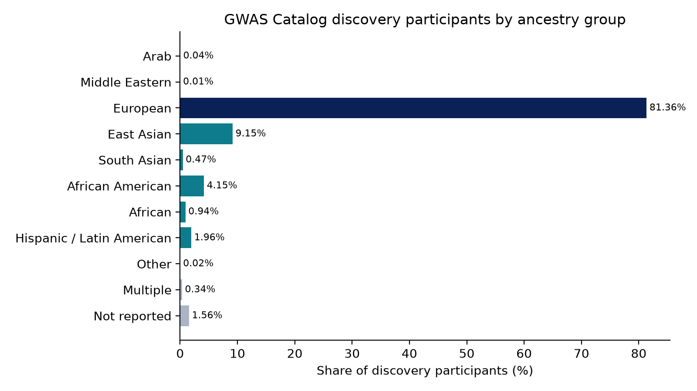
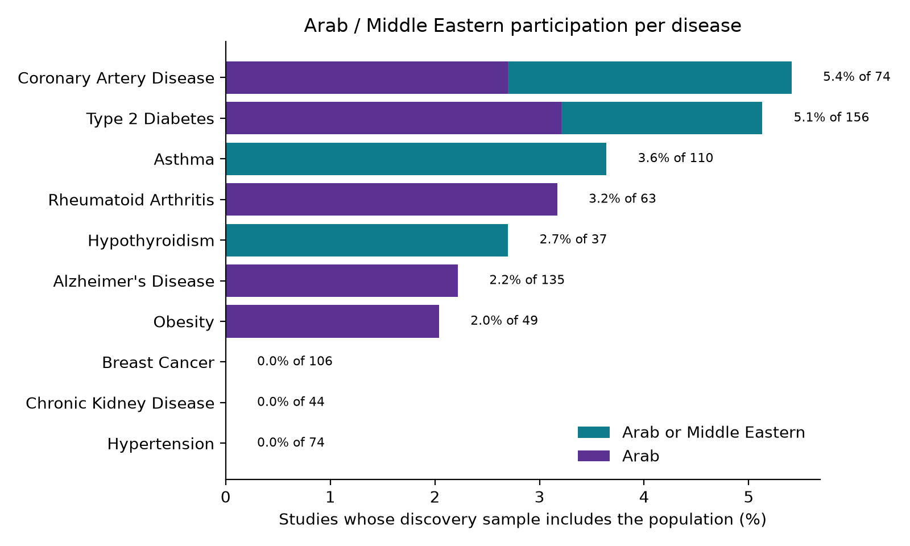
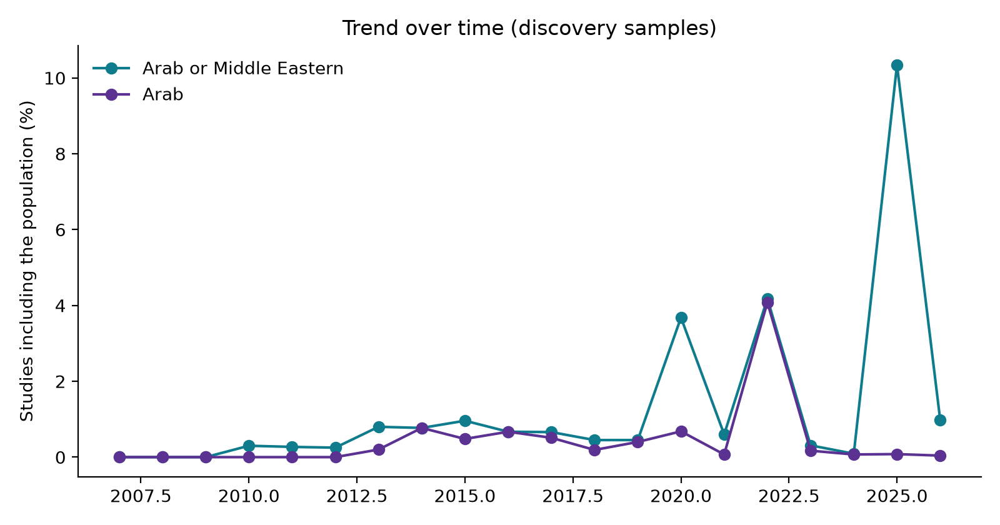

# 3.1 تمثيل الشعوب العربية والشرق أوسطية في دراسات GWAS

**السؤال البحثي:** ما نسبة دراسات الارتباط الجينومي، ونسبة المشاركين فيها، المستمدة من شعوب عربية أو شرق أوسطية، إجمالًا ولكل من الأمراض العشرة في المنصة، وكيف تغيّرت مع الزمن؟

**إعادة الإنتاج:** `python -m analysis.representation` (تكتب `analysis/results/` و `analysis/figures/`).

## البيانات
- نسخة محلية من ملف الارتباطات الكامل لكتالوج GWAS (`gwas_online_snapshot_20260703_175831.zip`).
- **الوحدة:** الدراسة (STUDY ACCESSION)، والعدد 73,443 دراسة، منها 848 دراسة تبلّغ عن ارتباطات لأحد الأمراض العشرة. اختيرت هذه الدراسات بمطابقة دقيقة للصفة المعيارية (EFO) المحددة لكل مرض في `data/metadata/disease_profiles.csv`.

## المنهجية
1. **التصنيف:** يُعتبر أن الدراسة "تشمل" شعبًا إذا ذكره وصف عينة الاكتشاف (INITIAL SAMPLE SIZE). عينات التكرار (replication) تُعرض في عمود منفصل.
2. **التعريف** (`core/regions.py`، بمطابقة كلمات كاملة):
   - **عربي:** جنسيات أو أسماء دول جامعة الدول العربية الـ22، أو كلمة "Arab".
   - **شرق أوسطي:** يشمل العربي، ويضيف الإيراني/الفارسي والتركي والكردي، وعبارة "Middle Eastern" الصريحة.
   - فئة الكتالوج "Greater Middle Eastern (Middle Eastern, North African or Persian)" تُحتسب شرق أوسطية وليست عربية، لأنها تخلط شعوبًا عربية وغير عربية. هذا اختيار محافظ.
3. **عدد المشاركين:** كل عنصر بصيغة "<عدد> <وصف>" في عينة الاكتشاف يُنسب إلى المجموعة المذكورة في وصفه. العنصر الذي يذكر أكثر من مجموعة يُصنّف "متعدد"، والذي لا يذكر أي مجموعة يُصنّف "غير مذكور".
4. **التحقق:** راجعتُ يدويًا كل الدراسات الـ23 المصنفة عربية أو شرق أوسطية ضمن الأمراض العشرة، وكلها صحيحة. دقة المصنف (الإصدار v2) مقاسة منهجيًا في `02_classifier_validation.md`.

## النتائج

### إجمالي الكتالوج

| المؤشر | كل الدراسات (73,443) | دراسات الأمراض العشرة (848) |
|---|---|---|
| دراسات تشمل عينة اكتشاف عربية | 666 (0.91%) | 13 (1.53%) |
| دراسات تشمل عينة اكتشاف عربية أو شرق أوسطية | 2,342 (3.19%) | 23 (2.71%) |
| دراسات بعينة أوروبية فقط | 64.7% | 40.8% |
| نسبة المشاركين العرب | 0.040% | 0.032% |
| نسبة المشاركين العرب أو الشرق أوسطيين | 0.047% | 0.042% |

### المشاركون حسب المجموعة السكانية (كل الكتالوج، عينات الاكتشاف)

| المجموعة | النسبة |
|---|---|
| أوروبية | 81.36% |
| شرق آسيوية | 9.16% |
| أمريكية من أصل أفريقي | 4.15% |
| لاتينية | 1.96% |
| أفريقية | 0.94% |
| جنوب آسيوية | 0.47% |
| **عربية** | **0.040%** |
| **شرق أوسطية غير عربية** | **0.007%** |
| متعددة / غير مذكورة | 1.91% |

### حسب المرض

| المرض | الدراسات | % بعينة عربية | % بعينة عربية أو شرق أوسطية | ارتباطات معنوية من دراسات عربية/شرق أوسطية |
|---|---|---|---|---|
| السكري من النوع الثاني | 156 | 3.21 | 5.13 | 804 من 6,827 |
| مرض الشريان التاجي | 74 | 2.70 | 5.41 | 50 من 2,256 |
| الربو | 110 | 0 | 3.64 | 133 من 2,703 |
| التهاب المفاصل الرثياني | 63 | 3.17 | 3.17 | 129 من 962 |
| قصور الغدة الدرقية | 37 | 0 | 2.70 | 414 من 2,172 |
| الزهايمر | 135 | 2.22 | 2.22 | 10 من 1,101 |
| السمنة | 49 | 2.04 | 2.04 | 8 من 1,029 |
| ارتفاع ضغط الدم | 74 | **0** | **0** | 0 من 2,219 |
| مرض الكلى المزمن | 44 | **0** | **0** | 0 من 174 |
| سرطان الثدي | 106 | **0** | **0** | 0 من 1,298 |

### الاتجاه الزمني
الجدول الكامل في `analysis/results/representation_by_year.csv`.

## الخلاصة
- الشعوب العربية تمثل **0.04%** من مشاركي دراسات الاكتشاف في كتالوج GWAS، و**0.91%** من الدراسات.
- ثلاثة أمراض شائعة في المنطقة (ارتفاع ضغط الدم، الكلى المزمن، سرطان الثدي) **لا توجد لها أي دراسة GWAS** بعينة اكتشاف عربية أو شرق أوسطية في الكتالوج.
- معظم الارتباطات العربية في السكري تأتي من عدد قليل من الدراسات، أبرزها من قطر ولبنان والسعودية.

## حدود التحليل
- **الاعتماد على النص الحر:** التصنيف يعتمد على وصف العينة المكتوب. العينات العربية غير الموصوفة بوضوح لن تُرصد (تقدير الحساسية في القسم 3.2).
- **تكرار المشاركين:** المشاركون في البنوك الحيوية الكبيرة يُحتسبون مرة لكل دراسة، فمجموع المشاركين ليس عدد أشخاص فعليين. هذا معروف في تدقيقات التنوع المشابهة، والمقارنة بين النسب تبقى صالحة.
- **النطاق:** الكتالوج يغطي الدراسات المنشورة والمنسّقة فقط. الدراسات العربية غير المدرجة فيه، مثل المنشورة إقليميًا، لا تظهر هنا.
- **التقسيم للأمراض:** يعتمد على مطابقة دقيقة للصفات المعيارية، فالدراسات الموسومة بصفات قريبة (مثل "ضغط الدم الانقباضي" بدل "ارتفاع ضغط الدم") غير محسوبة.
