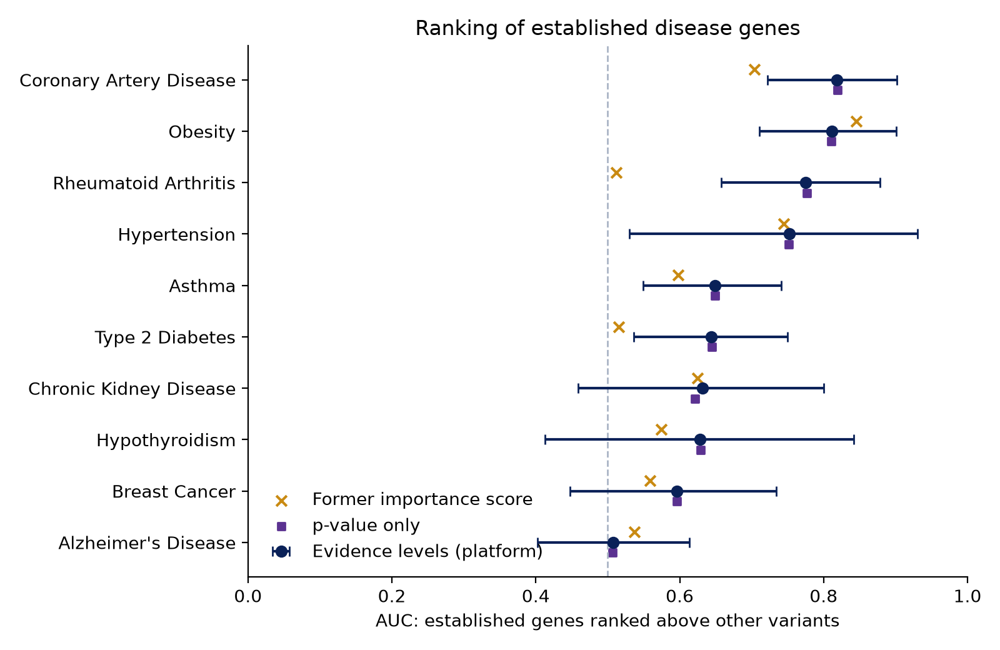

# 3.3 التحقق من ترتيب الارتباطات

**السؤال:** هل يضع ترتيب المنصة الجينات الراسخة علميًا لكل مرض في المراتب الأولى؟ وكيف يقارَن بالطريقة السابقة (درجة الأهمية الموزونة) وبالترتيب بقيمة p وحدها؟

**إعادة الإنتاج:** `python -m analysis.ranking_validation`

**النتائج الخام:** `analysis/results/ranking_validation_*`، والرسم `analysis/figures/fig4_ranking_validation.png`.

## طريقة المنصة الحالية: مستويات الدليل
استبدلنا درجة الأهمية الموزونة (0 إلى 100) بنظام يجيب عن سؤالين منفصلين:

| السؤال | الحقل | القاعدة |
|---|---|---|
| ما مدى موثوقية الارتباط؟ | **مستوى الدليل** (شارة وفلتر) | **مؤكَّد:** p < 5×10⁻⁸ في دراستين مستقلتين أو أكثر · **قوي:** في دراسة واحدة · **مقترح:** p < 10⁻⁵ |
| ما مدى قوته؟ | **الترتيب** | أفضل قيمة p في كامل الكتالوج، ثم المستوى، ثم حجم التأثير (‎\|log OR\|‎ أو ‎\|β\|‎)، ثم حجم العينة |

- **الدراسات المستقلة** = أرقام PubMed مختلفة، تُعدّ على **كامل كتالوج GWAS** (`pipeline/evidence_summary.py`)، لا على السجلات الخمسة المحفوظة لكل متغير. هذا يعالج المشكلة التي وجدناها في النسخة السابقة من هذا التحليل.
- **العينات العربية** لم تعد جزءًا من الدليل؛ تظهر شارةً وفلترًا منفصلين.
- **لماذا هذا التصميم؟** عتبة 5×10⁻⁸ والتكرار المستقل هما المعياران المعتمدان في دراسات GWAS، فلا توجد أوزان اعتباطية نحتاج لتبريرها.

**توزيع المستويات (1,444 متغيرًا):** 633 مؤكَّدًا (44%) و811 قويًا (56%). كل البيانات الحالية تبلغ عتبة الجينوم؛ المستوى «مقترح» يخص البيانات التي يضيفها الأدمن.

## المرجع الخارجي
**الملف:** `analysis/reference/established_loci.csv`، وفيه 74 جينًا للأمراض العشرة.

**مصدر الجينات:** كل جين مأخوذ من **ملخص (abstract)** الورقة التي اكتشفته، مع رقم PubMed، وقد تحققنا من الأسماء عبر واجهة NCBI الرسمية (E-utilities).

| المرض | المصادر (PMID) |
|---|---|
| السكري من النوع الثاني | Grant 2006 (16415884), Sladek 2007 (17293876), Zeggini 2007 (17463249) |
| السمنة | Frayling 2007 (17434869), Loos 2008 (18454148), Willer 2009 (19079261) |
| ارتفاع ضغط الدم | Newton-Cheh 2009 (19430483) |
| الشريان التاجي | Helgadottir 2007 (17478679), MIGen 2009 (19198609), Clarke 2009 (20032323) |
| الكلى المزمن | Köttgen 2009 (19430482) |
| الربو | Moffatt 2010 (20860503) |
| قصور الغدة الدرقية | Eriksson 2012 (22493691) |
| التهاب المفاصل الرثياني | Begovich 2004 (15208781), Plenge 2007 (17804836), Remmers 2007 (17804842) |
| الزهايمر | Harold 2009 (19734902), Lambert 2009 (19734903), Seshadri 2010 (20460622), Hollingworth 2011 (21460840), Lambert 2013 (24162737) |
| سرطان الثدي | Easton 2007 (17529967) |

**ملاحظات:** مصادر الشريان التاجي تخص احتشاء عضلة القلب؛ جينات HLA تُعدّ موقعًا واحدًا؛ الأسماء القديمة رُبطت بالحالية (TNRC9 = TOX3، CDKN2B = CDKN2B-AS1).

## المنهجية
- **الوحدة:** متغير واحد لكل مرض، بأفضل سجل له، كما يظهر في صفحة البحث.
- **"متغير مرجعي":** المتغير الذي جينه المرتبط ضمن قائمة المرض المرجعية.
- **AUC:** احتمال أن يأتي متغير مرجعي عشوائي قبل متغير آخر عشوائي. القيمة 0.5 = الصدفة.
- **فترات الثقة:** 95% بطريقة bootstrap (2,000 تكرار).
- **الاختبار المجمّع:** اختبار تبديل طبقي (5,000 تبديل داخل كل مرض).
- **مقارنة الطريقتين:** فرق AUC لكل مرض، مع bootstrap طبقي للفرق.
- **الدرجة السابقة** محفوظة كما هي في `analysis/legacy_ranking.py` لتكون المقارنة عادلة وقابلة للإعادة.

## النتائج

| الترتيب | متوسط AUC | قيمة p (تبديل) |
|---|---|---|
| **ترتيب المنصة الحالي (مستويات الدليل)** | **0.68** | 0.0002 |
| درجة الأهمية السابقة | 0.62 | 0.0002 |
| قيمة p وحدها (من السجلات المحفوظة) | 0.68 | 0.0002 |
| عدد الدراسات المستقلة وحده | 0.50 | 0.48 |

**الفرق بين الطريقة الحالية والسابقة:** **+0.060** (95%: 0.027 إلى 0.093)، وتحسّن الترتيب في **8 من 10** أمراض.

## التفسير
1. **الترتيب الجديد أفضل من السابق بفرق ذي دلالة إحصائية،** ويعادل أفضل مرجعية بسيطة (قيمة p).
2. **التكرار وحده لا يميّز «الجينات الكلاسيكية».** هذا متوقع: كثير من المواقع المؤكَّدة اكتُشفت بعد أوراق الاكتشاف الأولى التي بُني منها المرجع. لكن المتغيرات المؤكَّدة تحوي جينات مرجعية أكثر من القوية (20% مقابل 15%)، فالمستوى يحمل معلومة عن الموثوقية.
3. **لذلك فصلنا السؤالين:** الترتيب حسب القوة، والمستوى للموثوقية. أول نسخة جربناها رتّبت حسب المستوى أولًا، فأعطت 0.62 لأنها تؤخر متغيرات قوية جدًا من دراسة واحدة ضخمة.

## إفصاح عن خطر التحيّز
- **قرار اعتماد مستويات الدليل** اتُّخذ لأسباب علمية قبل رؤية النتائج.
- **أما قرار الترتيب حسب قيمة p أولًا** فاتُّخذ بعد رؤية نتيجة هذا المرجع. للتخفيف من التحيز: لم نضبط أي وزن أو عتبة؛ اخترنا أبسط ترتيب ممكن، وهو المرجعية التي كانت أفضل طريقة في النسخة السابقة من هذا التحليل.
- **التحقق النهائي** يجب أن يكون على مرجع مستقل لم يُستخدم في التطوير، مثل جينات من أوراق أحدث.

## حدود التحليل
- **قائمة المرجع محدودة:** تمثل "الجينات الكلاسيكية" لا كل الجينات الصحيحة؛ متغير غير مرجعي ليس بالضرورة خاطئًا.
- **ربط المتغير بالجين:** يعتمد على الجين المرتبط في الكتالوج (mapped gene)، وقد لا يكون الجين المسبب.
- **الدراسات المستقلة** تُعدّ بأرقام PubMed المختلفة؛ قد تشترك ورقتان في نفس المشاركين (مثل تحليلات تجميعية)، فالعدد حدٌّ أعلى للاستقلال الحقيقي.
- **عدد المتغيرات المرجعية قليل** في بعض الأمراض (8 إلى 10)، لذلك فترات الثقة واسعة.
